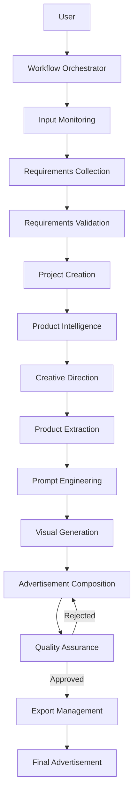

# NOVA ADS STUDIO

### AI-Powered Multi-Agent Advertisement Generation Platform

NOVA ADS STUDIO is a modular, AI-powered advertisement generation platform designed to transform a product image and user-provided creative requirements into professionally composed advertisements.

The platform uses a coordinated multi-agent architecture in which specialized AI components handle product understanding, creative planning, object extraction, prompt engineering, visual generation, advertisement composition, quality assurance, and final export.

Rather than relying on a single AI model to generate an entire advertisement, NOVA ADS STUDIO separates the creative production process into independent, specialized stages.

The primary objective is to generate high-quality advertisements while preserving the original product's identity, appearance, branding, and user-provided information.

---

## Table of Contents

1. [Project Vision](#1-project-vision)
2. [Core Objectives](#2-core-objectives)
3. [Key Features](#3-key-features)
4. [Complete Advertisement Workflow](#4-complete-advertisement-workflow)
5. [Multi-Agent Architecture](#5-multi-agent-architecture)
6. [Technical Architecture](#6-technical-architecture)
7. [Technology Stack](#7-technology-stack)
8. [Project Lifecycle](#8-project-lifecycle)
9. [Product Image Processing](#9-product-image-processing)
10. [Creative Generation Pipeline](#10-creative-generation-pipeline)
11. [Advertisement Composition](#11-advertisement-composition)
12. [Quality Assurance](#12-quality-assurance)
13. [Data Management](#13-data-management)
14. [Session Management and Recovery](#14-session-management-and-recovery)
15. [Supported Platforms and Placements](#15-supported-platforms-and-placements)
16. [Project Structure](#16-project-structure)
17. [Installation and Setup](#17-installation-and-setup)
18. [Running the Application](#18-running-the-application)
19. [Development Roadmap](#19-development-roadmap)
20. [Current Implementation Status](#20-current-implementation-status)
21. [Design Principles](#21-design-principles)
22. [Future Possibilities](#22-future-possibilities)

---

## 1. Project Vision

Traditional advertisement creation often requires multiple independent tools, manual editing, graphic design expertise, and repeated iterations.

NOVA ADS STUDIO aims to automate this process through an intelligent, modular production pipeline.

The platform accepts:

- Original product images.
- Brand logos.
- Campaign objectives.
- Target audience information.
- Advertising platforms and placements.
- Creative styles and visual preferences.
- Headlines, offers, prices, and call-to-action text.
- Additional instructions and reference materials.

It then processes these inputs through specialized AI stages to produce a final advertisement.

### Core concept

**Input → Understand → Plan → Extract → Engineer Prompts → Generate → Compose → Validate → Export**

The system is designed to be extensible. Although advertisement generation is the initial application, its underlying architecture can support additional content-generation workflows in the future.

---

## 2. Core Objectives

### 2.1 Product identity preservation

The original uploaded product image is the primary source of truth.

The platform should preserve the product's:

- Shape and proportions.
- Physical appearance.
- Branding and visible logos.
- Product-specific details.
- Colors and distinctive characteristics.

Generated backgrounds and creative elements should complement the product rather than replace or inaccurately recreate it.

### 2.2 Specialized AI responsibilities

Each stage has a specific responsibility. This avoids putting the entire production process into one large prompt or one general-purpose model.

### 2.3 Modular architecture

Each processing component should be independently maintainable and replaceable.

A model can be upgraded without requiring a complete redesign of the platform.

### 2.4 User-controlled creativity

The user controls campaign requirements, visual direction, advertisement content, and important brand constraints.

The system can generate creative suggestions, but explicitly supplied requirements must be respected.

### 2.5 Quality-driven generation

The platform should validate the generated advertisement before considering it complete.

A generated image is not automatically a successful advertisement.

---

## 3. Key Features

| Feature | Description |
|---|---|
| Product image intake | Detect and register uploaded product images |
| Conversational requirements | Collect advertising requirements through an interactive conversation |
| Structured validation | Convert answers into validated project data |
| Product intelligence | Understand the product using vision-language models |
| Object extraction | Extract the original product from its background |
| Prompt engineering | Generate detailed visual-generation prompts |
| AI image generation | Generate advertising backgrounds and creative visuals |
| Original product preservation | Reuse the extracted original product in final composition |
| Brand integration | Incorporate logos and brand assets |
| Dimension management | Generate platform-specific advertising sizes |
| Advertisement composition | Combine visual assets, product, text, logo, and CTA |
| Quality assurance | Inspect generated advertisements for visual and textual issues |
| Export management | Produce final advertising assets |

---

## 4. Complete Advertisement Workflow

The following describes the intended end-to-end production workflow.

### Stage 1 — Project Initialization

The user starts a new advertisement project.

The system:

1. Initializes the central workflow.
2. Creates or identifies a project session.
3. Starts monitoring the input directory.
4. Waits for a product image.
5. Detects newly uploaded files.
6. Validates the uploaded file.
7. Registers the image for processing.

Example:

```text
storage/
└── input/
    ├── product.png
    └── brand_logo.png
```

The product image and brand assets are registered separately.

### Stage 2 — Requirements Collection

The system starts an interactive requirements-collection process.

The user is asked about:

**Project information**
- Project name.
- Campaign purpose.
- Campaign objectives.

**Target audience**
- Age group.
- Gender preference.
- Geographic location.
- Interests.
- Customer type.

**Advertising placement**
- Platform.
- Placement type.
- Output dimensions.

**Creative direction**
- Visual style.
- Preferred colors.
- Colors to avoid.
- Emotional mood.
- Background preference.
- Composition preference.
- Reference descriptions.

**Advertisement content**
- Headline.
- Subheadline.
- Description.
- Slogan.
- Tagline.
- Offer.
- Price.
- Promo code.
- Disclaimer.
- Contact information.
- Website.
- Call-to-action text.

**Brand information**
- Logo requirement.
- Brand logo.
- Brand guidelines.
- Font preferences.
- Reference images.

**Additional instructions**
- Restrictions.
- Creative concepts.
- Other requirements.

The conversation engine uses structured questions and validates the collected responses.

### Stage 3 — Requirements Validation

Collected responses are converted into structured project requirements.

The system checks:

- Required fields.
- Missing information.
- Invalid values.
- Platform compatibility.
- Placement compatibility.
- Uploaded asset availability.
- Requirement completeness.

The user receives a requirements summary before project creation.

The user can confirm or reject the proposed project requirements.

### Stage 4 — Project Creation

After confirmation:

1. The project is registered in the database.
2. A unique project identifier is generated.
3. Requirements are stored.
4. Uploaded assets are associated with the project.
5. The project becomes available for downstream processing.

Example:

```text
Project Name: Asus

Project ID:
988374a5-3a21-4a8f-bf2c-487be4034ab7

Status: Created
Requirements Completion: 100%
```

### Stage 5 — Product Intelligence

The uploaded product image is analyzed using a vision-language model (VLM).

The objective is to understand what the product actually is before generating its advertisement.

Expected information includes:

- Product category.
- Product type.
- Visible brand.
- Product appearance.
- Main colors.
- Physical characteristics.
- Distinctive visual features.
- Product positioning.
- Potential advertising angles.

The output is a structured product intelligence report.

This report becomes the foundation for creative planning and prompt engineering.

### Stage 6 — Creative Direction

The system combines:

- Product intelligence.
- Campaign purpose.
- Target audience.
- User requirements.
- Brand guidelines.
- Advertising placement.

It develops a creative direction for the advertisement.

Expected output:

- Creative concept.
- Visual theme.
- Background direction.
- Lighting direction.
- Composition strategy.
- Color strategy.
- Typography direction.
- Product positioning.
- Advertising mood.

The creative direction must remain consistent with the user's requirements.

### Stage 7 — Product Extraction

The product is separated from its original background using a segmentation model such as Segment Anything Model 3 (SAM 3).

Expected output:

- Product mask.
- Extracted product image.
- Transparent background.
- Product bounding information.
- Extraction metadata.

The extracted product is retained as a reusable asset.

The original product image remains available as the source of truth.

### Stage 8 — Prompt Engineering

The system converts the creative direction into a detailed image-generation prompt.

The prompt can include:

- Scene description.
- Background environment.
- Lighting.
- Camera perspective.
- Composition.
- Color palette.
- Visual hierarchy.
- Empty space for typography.
- Product placement.
- Advertising style.
- Aspect ratio.

The prompt should be optimized for the selected image-generation model.

The generated background should not introduce inaccurate replacement products or misleading product details.

### Stage 9 — AI Visual Generation

The image-generation pipeline creates the visual environment for the advertisement.

A diffusion-based image-generation model generates:

- Backgrounds.
- Creative environments.
- Decorative visual elements.
- Lighting effects.
- Supporting visual elements.

The generated visual is intended to complement the original product.

The product itself should be composited from the extracted original asset wherever feasible.

### Stage 10 — Advertisement Composition

The generated visual, original product, brand logo, and advertisement content are combined.

Composition includes:

- Product placement.
- Background integration.
- Logo placement.
- Headline.
- Supporting text.
- Offer and price.
- Call-to-action.
- Typography.
- Spacing.
- Visual hierarchy.
- Platform-specific dimensions.

Pillow, OpenCV, SVG, or other suitable composition technologies can be used.

This stage is responsible for producing the actual advertisement layout.

### Stage 11 — Quality Assurance

The generated advertisement is inspected before export.

Validation can include:

**Visual validation**
- Product visibility.
- Product identity preservation.
- Logo visibility.
- Composition balance.
- Text placement.
- Background consistency.
- Visual quality.

**Text validation**
- OCR-based text extraction.
- Headline correctness.
- Price correctness.
- Offer correctness.
- CTA correctness.
- Text clipping and readability.

**Requirement validation**
- Correct advertising dimensions.
- Correct brand assets.
- User instructions followed.
- Required content present.

If validation fails, the advertisement can be returned for correction or regeneration.

### Stage 12 — Export

After passing quality validation, the final advertisement is exported.

Planned output formats:

- PNG.
- JPEG.
- PDF.

Export metadata should include:

- Project ID.
- Output format.
- Image dimensions.
- Generation details.
- Quality-assurance status.
- Asset locations.

---

## 5. Multi-Agent Architecture

NOVA ADS STUDIO follows a specialized multi-agent architecture.

Each component is responsible for a clearly defined stage.

| Agent ID | Functional responsibility | Primary responsibility |
|---|---|---|
| 1001 | Workflow Orchestrator | Controls project lifecycle and coordinates processing |
| 1002 | Product Intelligence | Analyzes uploaded product images |
| 1003 | Creative Director | Develops the advertisement's creative direction |
| 1004 | Product Extraction | Segments and extracts the original product |
| 1005 | Prompt Engineer | Converts creative requirements into generation prompts |
| 1006 | Visual Generation | Generates backgrounds and creative visual assets |
| 1007 | Advertisement Composition | Combines all assets into the final layout |
| 1008 | Quality Assurance | Validates the generated advertisement |
| 1009 | Export Management | Produces final downloadable assets |
| 1010 | Requirements Analysis | Collects and validates user requirements |

### Agent independence

Each agent should have:

- A unique identifier.
- A defined responsibility.
- A configuration.
- Input and output contracts.
- A processing lifecycle.
- Error-handling capabilities.
- Logging.
- Status reporting.

Agents should communicate through defined workflow contracts rather than tightly coupling their internal implementations.

---

## 6. Technical Architecture

The platform uses a Python-based backend with a modular architecture.

### High-level architecture



### Infrastructure components

**Application layer**

Responsible for:

- Workflow orchestration.
- Agent initialization.
- Requirements management.
- Project lifecycle.
- Processing coordination.

**AI processing layer**

Responsible for:

- Vision-language inference.
- Image segmentation.
- Prompt generation.
- Diffusion-based image generation.
- OCR and visual validation.

**Data layer**

Responsible for:

- Project storage.
- Requirement storage.
- Session management.
- Asset registration.
- Processing metadata.

**Infrastructure layer**

Responsible for:

- Redis.
- MySQL.
- File storage.
- Logging.
- Monitoring.
- Model execution.

---

## 7. Technology Stack

The following technologies form the current and planned technology stack.

| Category | Technology |
|---|---|
| Primary language | Python |
| Python version | Python 3.14.3 development environment |
| Backend architecture | Modular Python services |
| Data validation | Pydantic |
| Database | MySQL |
| Database toolkit | SQLAlchemy |
| Session and queue infrastructure | Redis |
| Redis environment | Ubuntu 24.04 WSL2 |
| Image processing | Pillow |
| Computer vision | OpenCV |
| Product understanding | Vision-Language Models |
| Product segmentation | SAM 3 |
| Prompt generation | Large Language Models |
| Visual generation | Diffusion models |
| Text validation | OCR |
| Development environment | Windows 11 |
| Database management | DBeaver |

Some AI components and integrations are planned for later implementation. Their inclusion here describes the intended architecture, not a claim that every model is currently operational.

---

## 8. Project Lifecycle

Every advertisement project should follow a controlled lifecycle.

```text
INITIALIZED
    |
    v
WAITING_FOR_INPUT
    |
    v
IMAGE_REGISTERED
    |
    v
REQUIREMENTS_COLLECTION
    |
    v
REQUIREMENTS_VALIDATION
    |
    v
AWAITING_CONFIRMATION
    |
    v
PROJECT_CREATED
    |
    v
PRODUCT_ANALYSIS
    |
    v
CREATIVE_PLANNING
    |
    v
PRODUCT_EXTRACTION
    |
    v
PROMPT_ENGINEERING
    |
    v
VISUAL_GENERATION
    |
    v
ADVERTISEMENT_COMPOSITION
    |
    v
QUALITY_ASSURANCE
    |
    +------> REVISION_REQUIRED
    |                |
    |                v
    |       COMPOSITION / GENERATION
    |
    v
APPROVED
    |
    v
EXPORT
    |
    v
COMPLETED
```

The actual implementation should persist processing states so that failures do not require restarting the entire project.

---

## 9. Product Image Processing

Product image processing is one of the most important parts of the platform.

The platform distinguishes between:

1. Original product image.
2. Extracted product image.
3. Generated creative background.
4. Final composed advertisement.

### Asset preservation

The original image should never be overwritten by intermediate processing.

Suggested asset organization:

```text
storage/
└── projects/
    └── project_id/
        ├── input/
        │   ├── product.png
        │   └── brand_logo.png
        │
        ├── product/
        │   ├── product_analysis.json
        │   ├── product_mask.png
        │   └── extracted_product.png
        │
        ├── creative/
        │   ├── creative_direction.json
        │   └── generation_prompt.txt
        │
        ├── generated/
        │   └── background.png
        │
        ├── composition/
        │   └── advertisement.png
        │
        ├── quality/
        │   └── qa_report.json
        │
        └── export/
            ├── advertisement.png
            ├── advertisement.jpg
            └── advertisement.pdf
```

This is the intended logical organization; the final directory structure may evolve with implementation.

---

## 10. Creative Generation Pipeline

The creative generation pipeline separates product understanding from image generation.

### Inputs

- Product intelligence report.
- Creative direction.
- User requirements.
- Platform dimensions.
- Brand guidelines.

### Processing

1. Generate a creative concept.
2. Determine visual composition.
3. Define background requirements.
4. Define lighting and atmosphere.
5. Determine product placement.
6. Reserve space for advertisement text.
7. Generate a model-specific prompt.
8. Generate the visual background.

### Important constraint

The diffusion model should primarily generate the creative environment.

The original product asset should be used in the final composition to reduce the risk of distorted branding, altered product details, or inaccurate product recreation.

---

## 11. Advertisement Composition

Advertisement composition is responsible for converting independent visual assets into a complete advertising design.

### Composition inputs

- Original or extracted product image.
- Generated background.
- Brand logo.
- Headline and supporting copy.
- Offer and price.
- Call-to-action.
- Target dimensions.
- Creative direction.

### Composition responsibilities

- Image scaling and positioning.
- Background and product integration.
- Logo placement.
- Typography and text rendering.
- Color consistency.
- Text hierarchy.
- Layout alignment.
- CTA design.
- Final image rendering.

### Exact text preservation

User-provided content may contain business-critical information.

Examples include:

- Product price.
- Discount percentage.
- Promotional code.
- Legal disclaimer.
- Website.
- Contact information.

Such content should be treated as controlled input and validated against the final output.

---

## 12. Quality Assurance

Quality assurance is a mandatory stage in the intended production pipeline.

A successful generation process must not be confused with a successful advertisement.

### Validation categories

| Category | Validation |
|---|---|
| Product | Original product identity preserved |
| Logo | Correct brand logo used |
| Typography | Text is readable |
| OCR | Required text is present |
| Price | Exact user-provided price |
| Offer | Exact user-provided offer |
| CTA | Correct call-to-action |
| Dimensions | Correct output dimensions |
| Layout | No unintended clipping or overlap |
| Visual quality | Acceptable composition and image quality |
| Requirements | User instructions followed |

### QA output

The quality-assurance stage should produce a structured report.

Example:

```json
{
  "project_id": "project_id",
  "status": "approved",
  "checks": {
    "product_identity": true,
    "logo_validation": true,
    "text_validation": true,
    "price_validation": true,
    "offer_validation": true,
    "dimension_validation": true,
    "visual_quality": true
  },
  "issues": [],
  "revision_required": false
}
```

This is an illustrative output contract, not a claim that the QA implementation is complete.

---

## 13. Data Management

NOVA ADS STUDIO uses separate infrastructure for structured application data and session state.

### MySQL

MySQL is intended to store persistent application data, including:

- Projects.
- Project requirements.
- Agent information.
- Asset metadata.
- Processing records.
- Quality reports.
- Export information.

### Redis

Redis is used for runtime session management and coordination.

Its responsibilities include:

- Intake sessions.
- Conversation state.
- Question progression.
- Temporary workflow data.
- Session recovery information.
- Coordination between processing components as the architecture evolves.

### Data ownership

The database should remain the persistent source of truth for project information.

Redis should not be treated as the only permanent storage location for important project data.

Uploaded files and generated assets should be stored independently of temporary session state.

---

## 14. Session Management and Recovery

The intake process is designed to support session resumption.

If the application process stops during requirements collection, the user should be able to resume the unfinished session rather than starting again.

The recovery process is:

1. Load the existing session identifier.
2. Retrieve the session state.
3. Restore previously collected answers.
4. Identify the current question.
5. Continue the conversation.
6. Complete validation and confirmation.

### Important infrastructure consideration

Session recovery across a complete machine or Redis restart requires Redis persistence to be configured appropriately.

Redis AOF or RDB persistence should be enabled and tested.

The application process itself does not automatically resume after a shutdown; it must be started again and the appropriate unfinished session resumed.

---

## 15. Supported Platforms and Placements

The dimensions configuration is designed to support multiple advertising platforms.

Current configured placements include:

| Platform | Placement | Dimensions |
|---|---|---|
| Instagram | Feed Square | 1080 × 1080 |
| Instagram | Feed Portrait | 1080 × 1350 |
| Instagram | Story | 1080 × 1920 |
| Instagram | Reels Cover | 1080 × 1920 |
| Facebook | Feed Square | 1080 × 1080 |
| Facebook | Feed Portrait | 1080 × 1350 |
| Facebook | Story | 1080 × 1920 |
| Facebook | Cover | 851 × 315 |
| YouTube | Thumbnail | 1280 × 720 |
| YouTube | Community Post | 1080 × 1080 |
| TikTok | Feed | 1080 × 1920 |
| LinkedIn | Feed Square | 1080 × 1080 |
| LinkedIn | Feed Landscape | 1200 × 627 |
| Website | Banner Landscape | 1920 × 600 |
| Website | Banner Square | 1080 × 1080 |

These are configured project dimensions and should be reviewed against current platform publishing specifications before production deployment.

The dimension loader supports placement aliases so that common user descriptions can map to canonical placement identifiers.

---

## 16. Project Structure

The project follows a modular organization.

The following is a logical target structure; individual directories and files may be added as implementation progresses.

```text
nova-ads-studio/
│
├── app/
│   ├── agents/
│   │   ├── workflow_orchestrator/
│   │   ├── product_intelligence/
│   │   ├── creative_director/
│   │   ├── product_extraction/
│   │   ├── prompt_engineer/
│   │   ├── visual_generation/
│   │   ├── advertisement_composition/
│   │   ├── quality_assurance/
│   │   ├── export_management/
│   │   └── requirements_analysis/
│   │
│   ├── core/
│   │   ├── config.py
│   │   └── logging.py
│   │
│   ├── database/
│   │
│   ├── intake/
│   │
│   ├── services/
│   │   ├── dimensions/
│   │   └── ...
│   │
│   └── main.py
│
├── config/
│   └── dimensions.json
│
├── scripts/
│   └── resume_intake.py
│
├── storage/
│   ├── input/
│   └── projects/
│
├── tests/
│
├── .env.example
├── .gitignore
├── requirements.txt
└── README.md
```

---

## 17. Installation and Setup

### Prerequisites

- Windows 11 or a compatible development environment.
- Python 3.14.3 for the current development environment.
- MySQL.
- Redis.
- Ubuntu 24.04 WSL2 for the current Redis development setup.
- Git.
- A virtual environment.

### Clone the repository

```bash
git clone <YOUR_GITHUB_REPOSITORY_URL>
cd nova-ads-studio
```

### Create a virtual environment

```powershell
python -m venv .venv
```

### Activate the virtual environment

```powershell
.venv\Scripts\Activate.ps1
```

### Install dependencies

```powershell
python -m pip install --upgrade pip
pip install -r requirements.txt
```

### Configure environment variables

Create a `.env` file based on `.env.example`.

Configure the database and Redis connection details.

Example configuration:

```env
APP_ENV=development

MYSQL_HOST=localhost
MYSQL_PORT=3306
MYSQL_DATABASE=nova_ads
MYSQL_USER=your_username
MYSQL_PASSWORD=your_password

REDIS_HOST=127.0.0.1
REDIS_PORT=6379
REDIS_DB=0
```

The variable names above are illustrative. Use the exact names expected by the application's configuration.

### Infrastructure setup

Ensure that:

1. MySQL is running.
2. The `nova_ads` database exists.
3. Redis is running.
4. Redis is reachable from the Python environment.
5. Required database tables have been initialized.
6. Required storage directories exist.

---

## 18. Running the Application

Activate the virtual environment:

```powershell
.venv\Scripts\Activate.ps1
```

Start the application:

```powershell
python -m app.main
```

The application initializes the workflow and begins waiting for a product image.

Place the product image inside:

```text
storage/input/
```

Follow the interactive requirements-collection process.

After all required information has been collected, review the project summary and confirm project creation.

### Resume an existing intake session

Use:

```powershell
python -m scripts.resume_intake
```

The resume script must reference the correct unfinished session ID.

---

## 19. Development Roadmap

### Phase 00 — Foundation

**Status: Complete**

- Project foundation.
- Initial architecture.
- Development environment.
- Core application organization.

### Phase 01 — Agent Organization and Registry

**Status: In progress**

- Agent organization.
- Agent identification and responsibilities.
- Modular intake architecture.
- Requirements collection.
- Redis session management.
- Project initialization.
- Project creation.
- Session recovery validation.

### Phase 02 — Product Intelligence

**Planned**

- VLM integration.
- Product classification.
- Product attribute extraction.
- Brand and visual identification.
- Structured product intelligence report.

### Phase 03 — Creative Direction and Product Extraction

**Planned**

- Creative strategy.
- Product segmentation.
- Product mask generation.
- Transparent product extraction.
- Asset validation.

### Phase 04 — Prompt Engineering and Visual Generation

**Planned**

- Prompt generation.
- Diffusion model integration.
- Background generation.
- Creative visual generation.
- Generation configuration.

### Phase 05 — Advertisement Composition

**Planned**

- Product placement.
- Logo integration.
- Typography.
- Offer and price placement.
- CTA integration.
- Dimension-specific rendering.

### Phase 06 — Quality Assurance

**Planned**

- VLM-based visual validation.
- OCR-based text verification.
- Product identity verification.
- Layout validation.
- Automatic revision workflow.

### Phase 07 — Export Management

**Planned**

- PNG export.
- JPEG export.
- PDF export.
- Export metadata.
- Project asset organization.

---

## 20. Current Implementation Status

The current development milestone is the requirements-intake and project-creation workflow.

### Implemented and tested

- [x] Modular project foundation.
- [x] Agent identification and registry foundation.
- [x] Central workflow initialization.
- [x] Input directory monitoring.
- [x] Product image detection.
- [x] Requirements conversation.
- [x] Structured answer extraction.
- [x] Requirements validation.
- [x] Platform and placement normalization.
- [x] Brand logo registration.
- [x] Requirements confirmation.
- [x] Database project creation.
- [x] Redis-based intake sessions.
- [x] Intake session resumption.
- [x] Two successful project creation tests.

### Pending

- [ ] Full Redis persistence and shutdown recovery test.
- [ ] Asset persistence verification.
- [ ] Complete requirements snapshot verification.
- [ ] Final pre-product-intelligence workflow test.
- [ ] Product intelligence implementation.
- [ ] Creative direction implementation.
- [ ] Product extraction implementation.
- [ ] Prompt engineering implementation.
- [ ] Visual generation implementation.
- [ ] Advertisement composition implementation.
- [ ] Quality assurance implementation.
- [ ] Export implementation.

**Current milestone:** Requirements collection and project creation are working. The next major implementation milestone is product intelligence.

---

## 21. Design Principles

The platform follows these architectural principles.

### Separation of concerns

Every component should have a clearly defined responsibility.

### Modular development

Components should be replaceable without rewriting the entire system.

### Structured communication

Processing stages should exchange structured data with defined contracts.

### Original asset preservation

Original product images and brand assets must remain available throughout processing.

### User requirement integrity

Explicit user requirements must not be silently changed during generation.

### Failure isolation

A failure in one processing stage should not unnecessarily destroy completed work.

### Resumable processing

Long-running workflows should be designed to resume from saved state.

### Observability

Every processing stage should provide useful logs, status information, and error details.

### Extensibility

The architecture should support future models, agents, technologies, and content-generation workflows.

---

## 22. Future Possibilities

NOVA ADS STUDIO is initially focused on product advertisement generation, but the architecture is intended to support additional capabilities.

Potential future extensions include:

- Multiple advertisement variations.
- Batch advertisement generation.
- Multiple product support.
- Brand-specific creative templates.
- Campaign-level asset management.
- Multiple diffusion model backends.
- Video advertisement generation.
- Automated social media content.
- Additional content-generation workflows.
- API-based project creation.
- Web-based management dashboard.
- Distributed AI inference.
- GPU worker orchestration.
- Scalable processing infrastructure.

These are future possibilities rather than currently implemented features.

---

## Project Status

**NOVA ADS STUDIO is under active development.**

The foundational project workflow and requirements collection have been implemented and tested. The remaining AI production stages are being developed incrementally.

The long-term goal is to build a modular, reliable, multi-agent creative production platform capable of turning structured user requirements and original product assets into high-quality advertising content.

---

## License

License information will be added when the project license is selected.

## Contributions

Contribution guidelines will be added as the project architecture and development workflow mature.

---

**NOVA ADS STUDIO — From Product Image to Professional Advertisement.**
